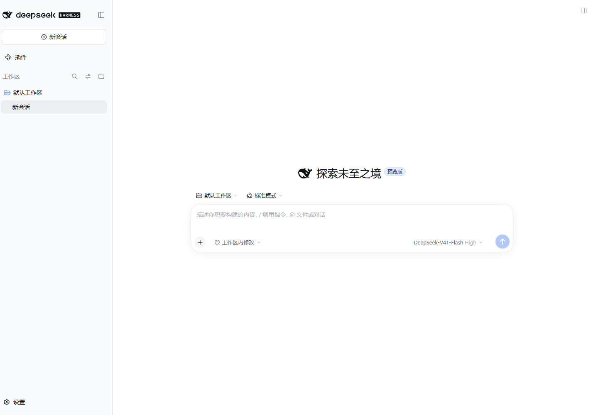

# DeepSeek Harness Portable

Run the official DeepSeek Harness from one movable folder: unzip, launch, and carry your workspace and sessions with you.
No preinstalled Node.js and no system PATH changes; the wrapper only handles bootstrap, directory isolation and migration, leaving the official Web UI, plugins and model configuration untouched.

[](https://github.com/Tsungloong/deepseek-harness-portable/actions/workflows/ci.yml)
[](https://github.com/Tsungloong/deepseek-harness-portable/releases/latest)
[](LICENSE)

[中文](README.md) · [Download latest](https://github.com/Tsungloong/deepseek-harness-portable/releases/latest) · [User guide](docs/user-guide.md)

Portable **1.0.2** / official Harness **0.2.1-rc.2** (Node.js 24.21.0, pnpm 11.28.0).



## Quick start

- **Windows 10/11 x64:** unzip, then double-click `windows.bat`.
- **Linux x64 (glibc):** `sh linux.sh`
- **macOS Apple Silicon:** `sh mac.sh`

The first launch downloads and verifies the pinned Node.js and official Harness; later launches reuse them. Open the complete URL printed after **`dsh web:`** (it contains an access token). Press **Ctrl+C** to stop.
First install needs network access; afterwards the UI can start offline, while cloud inference still needs network and credentials. Configure models and API endpoints in the official workbench.

## Commands

`windows.bat` on Windows; use `sh linux.sh` / `sh mac.sh` on Unix.

| Command | Purpose |
|---|---|
| `windows.bat` | Start the Web workbench |
| `windows.bat setup` | Install the pinned runtime; reuse an existing installation |
| `windows.bat doctor` | Diagnose step by step with OK/WARN/FAIL (WARN means attention needed) |
| `windows.bat repair` | Reinstall Node and Harness while keeping `data/` |
| `windows.bat reset` | Delete data and runtimes after confirmation; keep `models/` and source |
| `windows.bat portable-update` | Verify and update the portable source; next launch installs its runtime |
| `windows.bat --version` | Show portable and official Harness versions |
| `windows.bat -- <args>` | Forward arguments unchanged to the official CLI, e.g. `-- --help` |
| `windows.bat web --port 3081` | Start on another port |

Updates are checked at most once every 24 hours and only announced; nothing is replaced while running. Set `DSH_PORTABLE_NO_AUTO_UPDATE=1` to disable checks.
`windows.bat portable-update --manifest <url>` points at a custom update source; the manifest must provide a full source archive URL and its SHA-256.

## Data and relocation

```text
deepseek-harness-portable/
├── windows.bat / linux.sh / mac.sh
├── scripts/                 launchers, manifest, dependency lock and repository checks
├── tests/                   behavior-level tests against a real installation
├── docs/                    user guide, troubleshooting and validation
├── models/                  user-provided files, preserved by reset
├── data/
│   ├── dsh-home/            sessions, settings, plugins and credentials
│   ├── agents-home/         shared Agent / Skills data
│   ├── portable-home/       child-process HOME and app caches
│   └── workspace/           Web launch directory, may hold portable projects
├── runtimes/<platform>/     Node.js, Harness, pnpm
├── packages/                download cache
├── state/                   installation and run state
├── logs/
└── temp/                    install and update staging
```

- After a full shutdown (Ctrl+C and wait for exit), copy the whole folder to move it to another location or machine; internal session paths, workspace registrations and projection caches migrate together, with `.portable-backup` files kept before rewrites.
- The official auto-created default workspace may also live under `data/portable-home/Documents/deepseek-harness/default-workspace/`; it travels with the folder.
- External projects are not copied with the folder; select their real location in the workbench on the destination machine. A different OS needs its own pinned runtime.
- `models/` is a preserved user directory, not a local inference service.

## Platforms and verification

Supported: Windows 10/11 x64, glibc Linux x64, Apple Silicon macOS. Not supported: Windows/Linux ARM64, Intel macOS and musl/Alpine.

Prefer NTFS on Windows, a Unix-permission filesystem such as ext4 on Linux, and APFS on macOS; allow at least 1 GiB. On Unix the official requirement is credential permissions `0600`; inside WSL keep the whole folder on the Linux filesystem, since exFAT and metadata-less Windows mounts do not qualify.

A release requires passing CI on Windows, Linux and macOS; the matching run is linked from the release notes. Local test scope and untested items are in [validation](docs/validation.md); the macOS desktop walkthrough is still pending.

## Security

Credentials are plain files under `data/`; the wrapper adds no encryption. **Anyone holding the folder may be able to use the accounts or API keys inside.**
Do not publish a personal installation; sign out and clear personal data before sharing, and revoke or rotate credentials if the device is lost. Report vulnerabilities per [SECURITY.md](SECURITY.md).

## Documentation

- [User guide](docs/user-guide.md): start and stop, workspaces, CLI passthrough, repair and reset, relocation, updates and the 0.2.1-rc.2 upgrade.
- [Troubleshooting](docs/troubleshooting.md): installation, ports, security software, paths and migration, update failures.
- [Validation](docs/validation.md): observed scope, CI coverage and untested items.
- [Docs index](docs/README.md) · [Changelog](CHANGELOG.md)

## Contributing and license

Maintainer **Tsungloong**. Issues and pull requests are welcome; see [CONTRIBUTING.md](CONTRIBUTING.md), read the [Code of Conduct](CODE_OF_CONDUCT.md), and report security issues privately per [SECURITY.md](SECURITY.md).

The portable bootstrap layer is Apache-2.0; the official Harness is installed unchanged under its own license. Third-party notices and trademark statements are in [NOTICE.md](NOTICE.md). This is an independent community project; DeepSeek names and marks belong to their owners.
